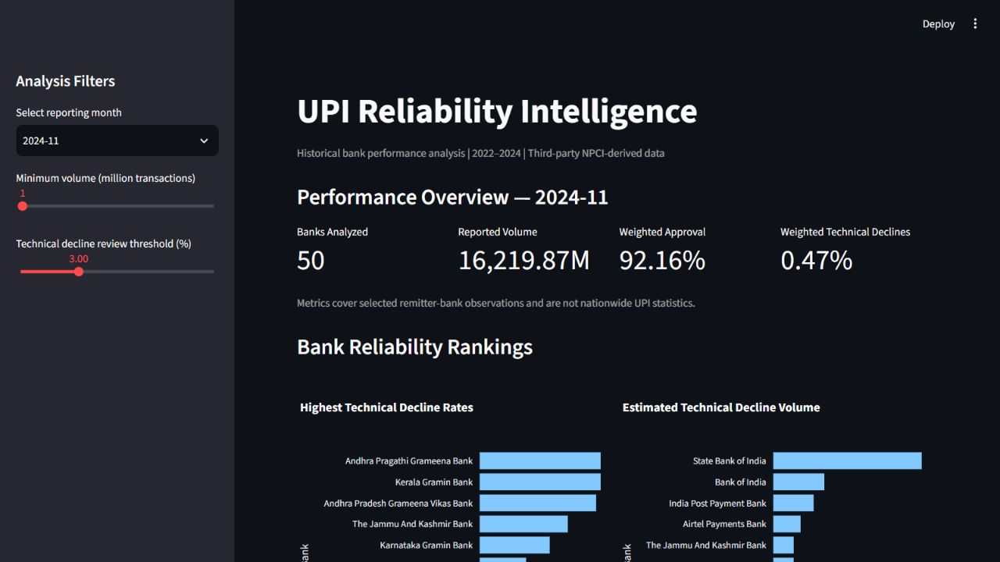
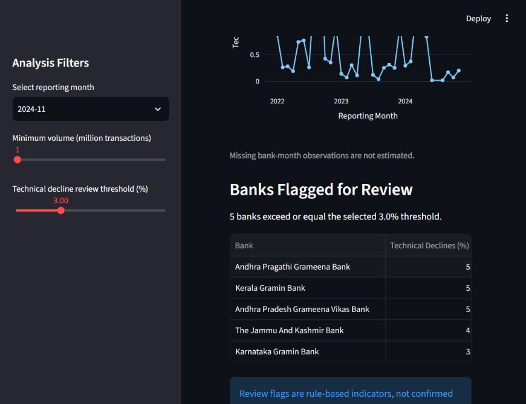

# UPI Reliability Intelligence

### Payment Failure Analysis | Python · SQL · Streamlit

A historical UPI analytics project that helps an analyst answer two different questions: **which remitter banks have the highest technical-decline rates, and which account for the most estimated declined transactions?**

It takes bank-month data through inspection, quality checks, documented cleaning, SQLite storage and an interactive dashboard. Built as a fintech internship portfolio project by [Amaan Shaikh](https://github.com/amaann190).



## Business problem

A high failure rate at a small bank and a lower failure rate at a large bank can imply very different transaction impact. Ranking both rate and estimated volume helps prioritize investigation. This project provides that comparison and lets an analyst examine a bank's history before drawing conclusions.

## Verified snapshot

November 2024, minimum reported volume **1 million transactions**, review threshold **3%**:

| Metric | Result |
|---|---:|
| Banks analyzed | 50 |
| Reported transaction volume | 16,219.87 million |
| Volume-weighted approval rate | 92.16% |
| Volume-weighted technical-decline rate | 0.47% |
| Banks flagged for review | 5 |

These results were reproduced locally on 29 October 2026. They describe the selected dataset observations, not independently verified nationwide UPI totals.

**A useful finding:** Andhra Pragathi Grameena Bank and Kerala Gramin Bank had the highest technical-decline rate in this selection, at 5.89%. State Bank of India had the highest estimated technical-decline volume, about 23.84 million, despite a lower rate of 0.57%. Rate and impact rankings support different investigation priorities; neither establishes a root cause.

## Dashboard features

- Reporting-month selection and minimum-volume filter.
- Adjustable technical-decline review threshold.
- Volume-weighted approval and decline KPI cards.
- Top-ten rankings by decline rate and estimated decline volume.
- Historical technical-decline trends for a selected bank.
- Flagged-bank table and expandable detailed records.



## Data and attribution

The included `data/raw/Remitter_Banks.csv` is third-party data from [UPI Ecosystem SQL Data Analysis](https://github.com/sudeshna999/UPI-Ecosystem-SQL-DataAnalysis). The original statistics publisher is [NPCI](https://www.npci.org.in/what-we-do/upi/upi-ecosystem-statistics). This project is independent and is not affiliated with or endorsed by NPCI.

The source data is included for reproducibility with attribution. It is not original data collected by the project author. Inclusion does not establish a redistribution license or grant rights to the third-party dataset; consult the original sources for their terms.

| Coverage / processing step | Verified result |
|---|---:|
| Original bank-month rows | 1,750 |
| Unique banks | 59 |
| Reporting months | 35: January 2022–November 2024 |
| Conflicting rows quarantined | 6 across 3 bank-month pairs |
| Reversal rates provisionally rescaled | 48 in August 2022 |
| Rows retained in SQLite | 1,744 |

### Cleaning decisions

1. Parse dates and trim bank-name whitespace.
2. Check rate completeness/ranges, nonnegative volume and transaction outcome totals (within one percentage point of 100%).
3. Provisionally divide reversal rates above 1 by 100 only when affected observations belong to August 2022 and do not exceed 100. Unexpected months or larger values stop processing. Original reversal values and a correction flag are preserved.
4. Quarantine **all rows** for duplicated bank-month keys rather than arbitrarily selecting one. See `data/processed/conflicting_bank_months.csv`.
5. Store the retained observations in SQLite as `bank_monthly`.

The reversal correction is a documented assumption, not a source-confirmed repair. Missing bank-month observations are not imputed; the current trend chart connects available observations.

## Methodology

Rates are stored as proportions: `0.03` means `3%`. Volumes are in millions of transactions.

```text
Estimated technical declines (million) = volume_million × technical_decline_rate
Weighted approval (%) = SUM(volume × approved_rate) / SUM(volume) × 100
Weighted technical declines (%) = SUM(volume × technical_decline_rate) / SUM(volume) × 100
Review flag = technical_decline_rate × 100 >= selected threshold (%)
```

Dashboard metrics and rankings use the selected month and minimum volume. The historical chart uses all available months for the chosen bank. The command-line analysis uses the latest available month, a 1-million minimum volume and a 3% threshold.

## Run locally

Tested with Python 3.13 on Windows. Run these commands from the repository root. SQLite is part of Python; no separate database server is needed.

```powershell
git clone https://github.com/amaann190/upi-reliability-intelligence.git
cd upi-reliability-intelligence
python -m venv .venv
.\.venv\Scripts\python.exe -m pip install -r requirements.txt

# Rebuild the included derived data from the raw CSV
.\.venv\Scripts\python.exe clean_data.py
.\.venv\Scripts\python.exe build_database.py
.\.venv\Scripts\python.exe analyze_reliability.py

# Verify and launch
.\.venv\Scripts\python.exe -m pytest -q
.\.venv\Scripts\python.exe -m streamlit run app.py
```

On macOS/Linux, use `.venv/bin/python` in place of `.\.venv\Scripts\python.exe`. Package versions in `requirements.txt` match the verified local environment; other operating systems have not been tested.

Optional inspection commands:

```powershell
.\.venv\Scripts\python.exe inspect_data.py
.\.venv\Scripts\python.exe validate_data.py
.\.venv\Scripts\python.exe diagnose_issues.py
```

`validate_data.py` reports raw-data issues; the 48 reversal-range violations and duplicated keys are expected before cleaning. The pipeline overwrites its derived CSV/database outputs; it preserves the raw CSV.

## Repository guide

| File | Purpose |
|---|---|
| `inspect_data.py` | Inspect schema, rows, missing values and exact duplicates |
| `validate_data.py` | Report coverage and raw-data quality issues |
| `diagnose_issues.py` | Examine duplicate keys and reversal anomalies |
| `clean_data.py` | Normalize, validate, quarantine and export cleaned data |
| `build_database.py` | Create SQLite `bank_monthly` and query latest rankings |
| `analyze_reliability.py` | Calculate latest-month KPIs, rankings and review flags |
| `app.py` | Interactive Streamlit dashboard |
| `tests/test_analytics.py` | Five data-integrity and regression checks |
| `data/raw/` | Attributed source CSV |
| `data/processed/` | Reproducible cleaned data, quarantine report, metrics and database |
| `docs/images/` | Screenshots of the running application |

## Validation

**5 tests passed** after rebuilding the data on 29 October 2026. The checks cover retained record count, unique bank-month keys, non-null rates within 0–1, November 2024 aggregate metrics and the five-bank review count.

These are dataset integrity and regression checks. They do not independently validate the upstream statistics, test every dashboard interaction, or provide isolated unit coverage of reusable calculation functions.

## Limitations

- Historical monthly observations, not real-time monitoring or transaction-level failure diagnosis.
- Third-party NPCI-derived data; source accuracy and nationwide completeness are not independently established.
- Reversal-rate rescaling remains provisional.
- Decline counts are estimates calculated from rounded source volumes and rates.
- Analyst-selected flags are investigation indicators, not confirmed outages, official NPCI limits or bank safety ratings.
- Quarantined and missing observations can affect coverage and comparisons.
- No live payment API, production deployment or measured business impact is claimed.

## Possible next steps

Add controlled-input tests for shared calculation functions, verify provisional corrections against original publications, and show missing periods explicitly in historical charts. These are future improvements, not completed features.
